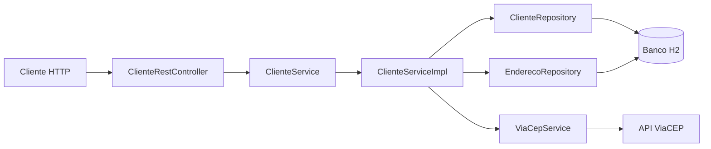
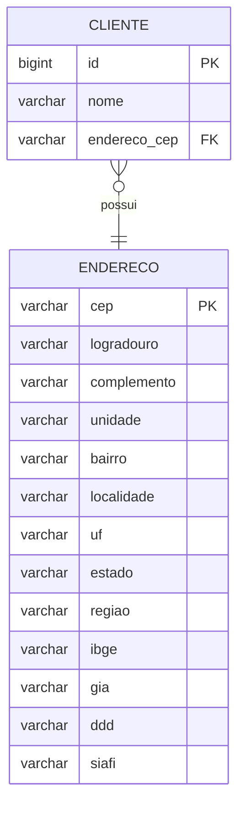

# Arquitetura e fluxo das requisições

## Visão em camadas



## Responsabilidade de cada camada

| Camada | Responsabilidade |
|---|---|
| Controller | Traduz HTTP em chamadas Java e devolve respostas HTTP |
| Service interface | Declara os casos de uso sem fixar uma implementação |
| Service implementation | Orquestra regras, repositórios e integração externa |
| Repository | Executa operações de persistência |
| Entity | Representa dados armazenados em tabelas |
| Feign client | Representa a API ViaCEP como uma interface Java |

## Fluxo de inserção de um cliente

O método mais importante para entender a arquitetura é a inserção:

```text
POST /clientes
  -> ClienteRestController.inserir()
  -> ClienteService.inserir()
  -> ClienteServiceImpl.inserir()
  -> ClienteServiceImpl.salvarClienteComCep()
  -> procura Endereco pelo CEP
  -> se não existir, ViaCepService.consultarCep()
  -> salva o Endereco
  -> vincula o Endereco ao Cliente
  -> ClienteRepository.save()
```

### O que acontece em cada etapa

1. O controller recebe um objeto `Cliente` enviado no corpo JSON.
2. Ele delega o trabalho à interface `ClienteService`.
3. A implementação percorre o endereço informado pelo cliente.
4. O método privado `salvarClienteComCep` verifica se o CEP já existe.
5. Quando não existe, o OpenFeign consulta `https://viacep.com.br/ws/{cep}/json/`.
6. ViaCEP devolve os dados que são convertidos em um objeto `Endereco`.
7. O endereço é salvo no repositório.
8. O endereço existente ou recém-carregado é associado ao cliente.
9. Por fim, o cliente é salvo.

## Por que o repositório de endereço existe

O projeto evita repetir o mesmo endereço para cada cliente. `Endereco` usa o CEP como `@Id`.

- vários clientes podem usar o mesmo endereço;
- o projeto procura o endereço pelo CEP antes de consultar ViaCEP;
- a consulta externa ocorre apenas quando o endereço ainda não está no banco.

## Dependências gerenciadas pelo Spring

O Spring cria e gerencia objetos anotados com `@Service`, `@Repository`, `@RestController` e `@FeignClient`.

Na implementação atual, `@Autowired` pede ao contêiner:

- um `ClienteRepository`;
- um `EnderecoRepository`;
- um `ViaCepService`;

O Spring resolve essas dependências e entrega as instâncias necessárias ao `ClienteServiceImpl`.

## Relação entre entidades



O relacionamento JPA é `@ManyToOne`: muitos clientes podem estar associados a um mesmo endereço.
